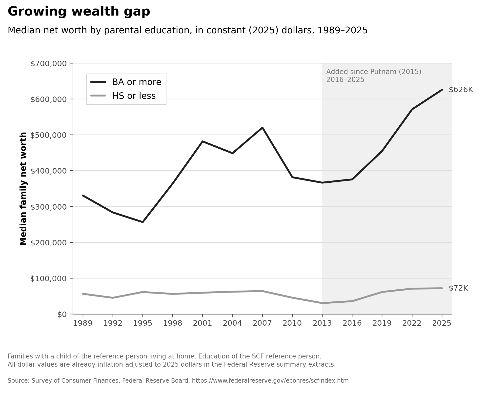

# POLISCI 158 — Section Assignment 3

Reproduction of **“Growing wealth gap” (median family net worth by parental education, 1989–2025)**, the first of the two supplied demo figures.

Data come from the Federal Reserve Board's [Survey of Consumer Finances](https://www.federalreserve.gov/econres/scfindex.htm), using the public CSV summary extracts for every triennial survey from 1989 through 2025. These extracts are already in constant 2025 dollars. `get_data.py` downloads the original data; no values are traced or transcribed from the picture.

Keep families with a child living at home (`KIDS > 0`). Calculate survey-weighted median `NETWORTH` for BA or more (`EDCL = 4`) and HS or less (`EDCL = 1 or 2`), using `WGT` across all five implicates. Education is that of the family reference person, not their own parents. Some college is excluded.

## Run

Requires Python 3.10+ and preferably curl (the downloader falls back to Python's standard library).

```sh
python -m pip install -r requirements.txt
python get_data.py
python plot.py
```

`figure.png` is the reproduction. `REPORT.md` explains the calculation and comparison; `data/estimates.csv` contains the computed series. The 2025 values round to the original's **$626K** and **$72K** labels. All raw downloads and source hashes are included. Use `python get_data.py --refresh` to redownload; review the release's dollar base if the Federal Reserve updates its files in the future.


